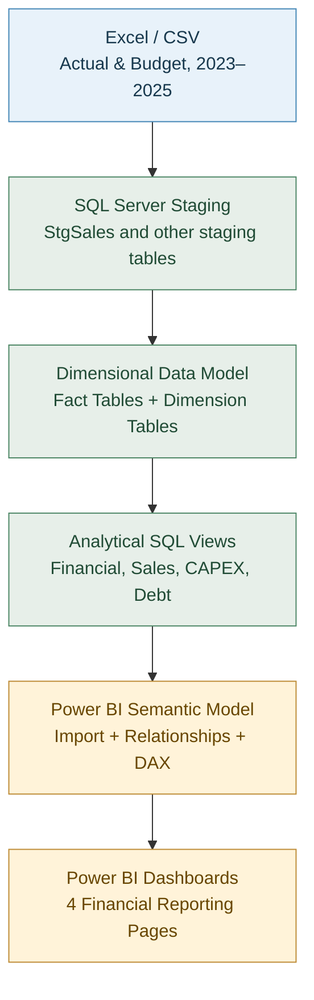
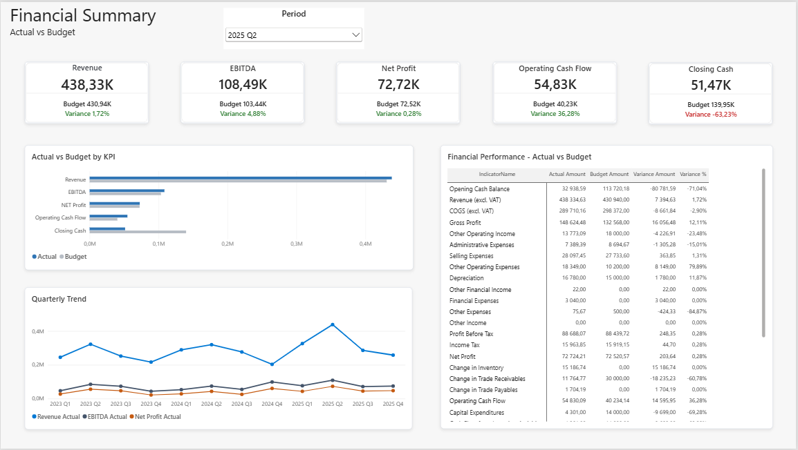
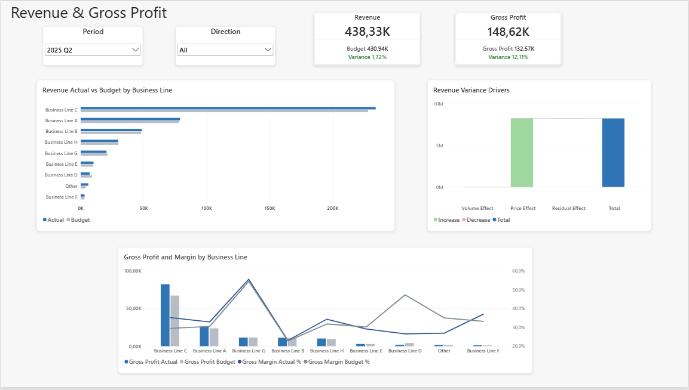
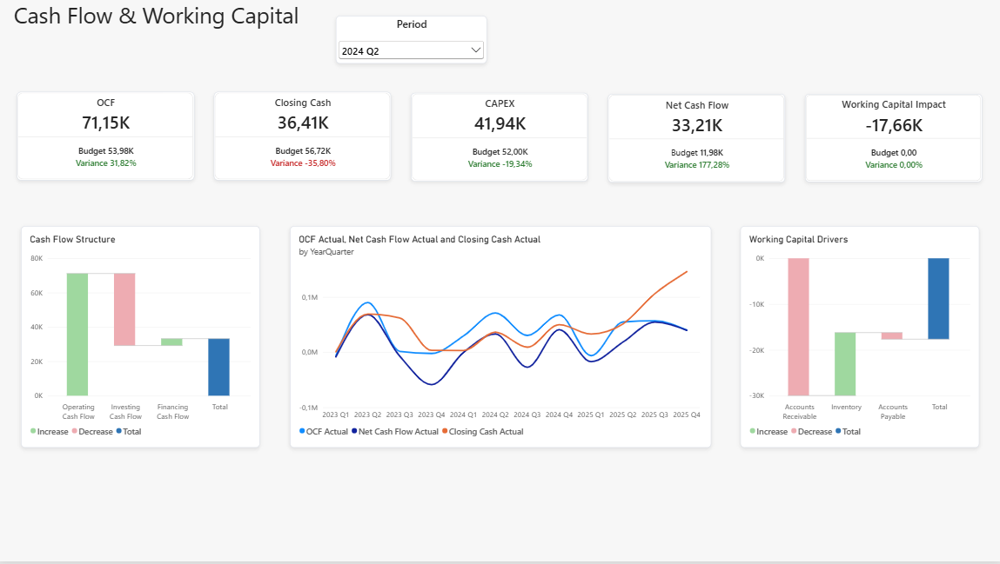
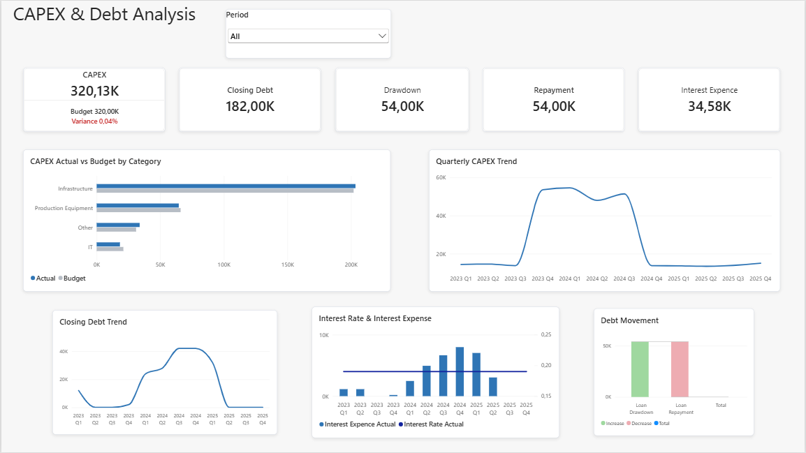

# Financial Analytics SQL & Power BI Portfolio

## 1. Project Overview

**Financial Analytics SQL & Power BI Portfolio** is an end-to-end financial analytics project designed to transform raw financial data into structured, reliable, and interactive management reports.

The project demonstrates the development of a financial reporting solution using **Microsoft SQL Server, T-SQL, Power Query, DAX, and Power BI**.

The solution integrates financial Actual and Budget data for 2023–2025, allowing users to analyze financial performance, identify budget variances, monitor cash flows, and evaluate capital investments and debt.

### Project Objectives

- Build a structured SQL Server database using a dimensional data model.
- Implement data loading and transformation processes.
- Create SQL views to support financial reporting and variance analysis.
- Develop interactive Power BI dashboards for management decision-making.
- Analyze key financial indicators across reporting periods.
- Ensure data consistency through reconciliation and validation.

### Key Analytical Areas

The Power BI solution consists of four dashboard pages:

1. **Financial Summary** — overview of revenue, profitability, cash flow, and financial performance against budget.
2. **Revenue & Gross Profit** — revenue analysis by business line, gross profit margins, and price-volume variance drivers.
3. **Cash Flow & Working Capital** — operating cash flow, working capital movements, and cash flow structure.
4. **CAPEX & Debt Analysis** — capital expenditures, debt balances, financing activities, and interest expenses.

### Project Scope

- **Reporting period:** 2023–2025
- **Reporting frequency:** Quarterly
- **Scenarios:** Actual and Budget
- **Data source:** Anonymized financial datasets prepared in Excel and CSV formats
- **Database platform:** Microsoft SQL Server
- **Reporting platform:** Microsoft Power BI

The project is developed as a portfolio case study to demonstrate practical skills in financial data modeling, SQL development, data transformation, financial analysis, and business intelligence reporting.

## 2. Business Problem

Manufacturing companies generate substantial amounts of financial and operational data across multiple reporting areas, including sales, production costs, operating expenses, working capital, cash flow, capital expenditures, and debt financing.

When financial reporting relies primarily on separate Excel files and manual calculations, management faces several challenges.

### Key Business Challenges

**1. Fragmented Financial Data**

Financial information is stored across multiple worksheets and reporting files, making it difficult to maintain a consistent view of company performance.

**2. Time-Consuming Actual vs Budget Analysis**

Comparing actual financial results with budget targets requires consolidating data from different sources, calculating variances, and identifying the underlying drivers of financial performance.

**3. Limited Visibility into Profitability Drivers**

Traditional financial reports may show changes in revenue and gross profit without clearly explaining the impact of sales volume, pricing, and business-line performance.

**4. Insufficient Cash Flow Transparency**

Changes in accounts receivable, inventory, and accounts payable affect operating cash flow. Without an integrated analytical model, it can be difficult to understand how working capital movements influence liquidity.

**5. Disconnected CAPEX and Debt Reporting**

Capital expenditures, debt balances, loan drawdowns, repayments, and interest expenses are often analyzed separately, limiting management's ability to assess investment activity and financing requirements.

### Proposed Solution

This project addresses these challenges by developing an integrated financial analytics solution that:

- Consolidates Actual and Budget financial data into a structured SQL Server database.
- Standardizes financial indicators, reporting periods, business lines, and scenarios.
- Uses SQL views to prepare consistent datasets for financial analysis.
- Automates financial calculations and variance analysis through SQL and DAX.
- Provides interactive Power BI dashboards for analyzing profitability, liquidity, investments, and debt.
- Enables management to identify financial performance drivers and monitor key indicators across reporting periods.

### Expected Business Value

The solution is designed to reduce manual reporting effort, improve data consistency, increase transparency in financial performance, and support faster, data-driven management decisions.

## 3. Tech Stack

The project combines database development, data transformation, financial analytics, and business intelligence technologies to build an end-to-end financial reporting solution.

### Database & SQL

| Technology                          | Purpose                                                                             |                         
|-------------------------------------|-------------------------------------------------------------------------------------|
| Microsoft SQL Server                | Relational database management and storage of financial data                        |
| T-SQL                               | Database creation, data loading, transformation, validation, and financial analysis |
| SQL Server Management Studio (SSMS) | Database administration, SQL query development, debugging, and data validation      |
| SQL Views                           | Preparation of reusable analytical datasets for Power BI                            |
| Dimensional Data Modeling           | Organization of financial information into fact and dimension tables                |

### Data Preparation & Transformation

| Technology         | Purpose                                                                                      |
|--------------------|----------------------------------------------------------------------------------------------|
| Microsoft Excel    | Source financial datasets containing Actual and Budget information                           |
| CSV                | Intermediate format for transferring financial data into SQL Server                          |
| Power Query        | Data cleaning, restructuring, and preparation for database loading                           |
| SQL Staging Tables | Temporary landing area for imported datasets before transformation into the analytical model |
| T-SQL ETL Scripts  | Loading and transforming source data into fact and dimension tables                          |

### Business Intelligence & Analytics

| Technology              | Purpose                                                                                 |
|-------------------------|-----------------------------------------------------------------------------------------|
| Power BI Desktop        | Development of interactive financial dashboards                                         |
| DAX                     | Calculation of KPIs, financial ratios, budget variances, and analytical measures        |
| Power BI Data Model     | Relationships between reporting views and dimension tables                              |
| Power BI Visualizations | KPI cards, trend charts, variance analysis, waterfall charts, and financial comparisons |

### Development & Version Control

| Technology               | Purpose                                                                       |
|--------------------------|-------------------------------------------------------------------------------|
| Visual Studio Code       | Development and organization of SQL scripts, documentation, and project files |
| Git                      | Version control and tracking of project changes                               |
| GitHub                   | Source code repository, documentation, and portfolio presentation             |
| Power BI Project (.pbip) | Source-controlled Power BI report and semantic model files                    |
| Markdown                 | Project documentation and README development                                  |

### Key Technical Capabilities Demonstrated

- Designing a dimensional financial data model with fact and dimension tables.
- Developing SQL scripts for database creation, data loading, and transformation.
- Implementing staging-to-fact data processing workflows.
- Creating reusable analytical SQL views.
- Applying SQL aggregation, joins, CTEs, and data validation queries.
- Developing DAX measures for financial KPIs and Actual vs Budget analysis.
- Building interactive Power BI reports with consistent visual formatting.
- Managing SQL and Power BI project files through Git and GitHub.

## 4. Data Architecture

The project follows a layered data architecture designed to separate source data preparation, data storage, transformation, analytical modeling, and business intelligence reporting.

Microsoft SQL Server serves as the central data platform, while Power BI provides the analytical and visualization layer.

### 4.1 Architecture Overview

The end-to-end data flow consists of five main layers:

**1. Source Data — Excel & CSV**

Anonymized financial datasets for 2023–2025, containing Actual and Budget information across multiple financial reporting areas.

**2. Staging Layer — SQL Server**

Source datasets are imported into staging tables, including `StgSales`, where data can be inspected, standardized, and prepared for transformation.

**3. Data Warehouse Layer — Dimensional Model**

Validated data is loaded into fact and dimension tables using a star-schema approach.

**4. Analytical Layer — SQL Views**

SQL views combine financial data with reporting dimensions and calculate or expose measures required for financial analysis.

**5. Reporting Layer — Power BI**

Power BI connects to SQL Server, imports analytical datasets, and uses DAX measures and interactive visualizations to deliver management dashboards.



  

### 4.2 Dimensional Data Model

The analytical database is organized around fact and dimension tables.

**Dimension Tables**

| Table                   |                                          Description |
|-------------------------|------------------------------------------------------|
| `DimCompany`            | Company identifiers and reporting entities           |
| `DimPeriod`             | Reporting years, quarters, and chronological sorting |
| `DimScenario`           | Actual and Budget scenarios                          |
| `DimDirection`          | Business lines and operating directions              |
| `DimFinancialIndicator` | Standardized financial indicators                    |
| `DimCapEx`              | Capital expenditure categories                       |
| `DimDebtMetric`         | Debt-related reporting metrics                       |

**Fact Tables**

| Table                                  | Description                                                          |
|----------------------------------------|----------------------------------------------------------------------|
| `FactFinancialData`                    | Financial performance, cash flow, and working capital indicators     |
| `FactSales`                            | Sales volume, selling price, and revenue by business line            |
| `FactCOGS`                             | Cost of goods sold data                                              |
| `FactCapEx`                            | Capital expenditure data                                             |
| `FactDebtSchedule`                     | Debt balances, financing movements, and interest-related information |

Fact tables store quantitative financial data and reference dimension tables through identifiers such as `CompanyId`, `PeriodId`, `ScenarioId`, and `DirectionId`, depending on the fact table's reporting grain.

This structure supports consistent filtering, aggregation, and comparative analysis across reporting periods and scenarios.

### 4.3 Analytical SQL Views

The reporting layer includes reusable SQL views designed to simplify Power BI integration and centralize financial reporting logic.

| SQL View                      | Analytical Purpose                                                   |
|-------------------------------|----------------------------------------------------------------------|
| `vw_FinancialReport`          | Standardized financial reporting dataset                             |
| `vw_ActualVsBudget`           | Comparison of actual performance against budget                      |
| `vw_GrossProfitAnalysis`      | Revenue, cost of sales, gross profit, and profitability analysis     |
| `vw_SalesPriceVolumeAnalysis` | Revenue variance decomposition into price and volume effects         |
| `vw_CapExAnalysis`            | Capital expenditure analysis and budget comparisons                  |
| `vw_DebtAnalysis`             | Debt balances, financing movements, repayments, and interest analysis|

These SQL views provide a reusable analytical interface between the underlying database tables and Power BI.

### 4.4 Power BI Semantic Model

Power BI uses imported SQL datasets and DAX measures to support interactive financial reporting.

The semantic model includes relationships between reporting views and relevant dimensions, including reporting periods and business directions.

DAX measures provide calculations for:

- Actual and Budget financial performance.
- Absolute and percentage variances.
- Revenue and Gross Profit analysis.
- Gross Margin percentages.
- Operating Cash Flow and Working Capital movements.
- CAPEX and debt-related indicators.

The reporting solution consists of four pages: Financial Summary, Revenue & Gross Profit, Cash Flow & Working Capital, and CAPEX & Debt Analysis.

### 4.5 Architectural Benefits

This layered architecture provides several advantages:

- **Separation of responsibilities:** Source preparation, data storage, analytical SQL logic, and dashboard calculations are organized into distinct layers.
- **Consistency:** Standardized dimensions and SQL views support consistent financial reporting.
- **Maintainability:** SQL scripts, data models, and Power BI project files can be maintained independently.
- **Reusability:** Analytical views can support multiple financial reports and visualizations.
- **Data quality:** Reconciliation and validation queries help identify inconsistencies between source and analytical data.
- **Extensibility:** Additional reporting periods, scenarios, financial indicators, and analytical views can be incorporated into the existing architecture.

The overall design demonstrates an end-to-end financial analytics workflow, combining relational data modeling, SQL-based transformation, analytical reporting, and interactive business intelligence.

## 5. ETL Process

The project implements an ETL (Extract, Transform, Load) workflow to convert anonymized financial data from Excel and CSV files into structured SQL Server tables suitable for financial analysis and Power BI reporting.

The workflow combines **Microsoft Excel, Power Query, CSV files, T-SQL scripts, and SQL Server staging tables**.

### 5.1 Source Data Preparation

The source datasets contain quarterly financial Actual and Budget information for 2023–2025.

The data covers the following reporting areas:

- Sales and revenue
- Cost of Goods Sold (COGS)
- Operating Expenses (OPEX)
- Cash Flow and Working Capital
- Capital Expenditures (CAPEX)
- Debt and Interest Expenses

Source files were anonymized to protect business-sensitive information while preserving the structure and relationships required for financial analysis.

### 5.2 Data Extraction

Financial data was extracted from Excel worksheets and prepared for SQL Server loading.

Power Query was used where necessary to restructure source data into a tabular format.

Key preparation activities included:

- Standardizing column names.
- Converting financial indicators into a consistent structure.
- Identifying reporting periods and scenarios.
- Mapping business directions.
- Converting numeric fields into appropriate formats.
- Exporting transformed datasets to CSV files.

This approach supports consistent data loading from different financial reporting worksheets.

### 5.3 Staging Layer

CSV datasets were loaded into SQL Server staging tables before being transferred into the analytical data model.

Staging tables provide an intermediate layer for inspecting and preparing source data.

For example, `StgSales` contains sales information by company, reporting period, scenario, and business direction.

The staging layer supports:

- Initial data inspection.
- Data type and format verification.
- Identification of missing or inconsistent values.
- Reconciliation with source datasets.
- Preparation for loading into fact tables.

T-SQL scripts, including SQL Server bulk-loading operations, were used to import CSV data.

### 5.4 Data Transformation

After loading data into staging tables, T-SQL transformations were used to prepare datasets for the dimensional model.

The main transformation activities included:

**Dimension Mapping**

Source values were mapped to standardized dimension identifiers, such as:

- `CompanyId`
- `PeriodId`
- `ScenarioId`
- `DirectionId`

**Financial Indicator Standardization**

Financial indicators were mapped to predefined reporting definitions to ensure consistent aggregation and analysis.

**Data Aggregation and Restructuring**

Source records were transformed into structures appropriate for the target fact tables, taking into account the reporting grain of each dataset.

**Data Type Conversion**

Financial values were converted into SQL numeric data types suitable for financial calculations and reporting.

### 5.5 Loading into the Dimensional Model

Transformed data was loaded into SQL Server fact tables, including:

| Fact Table          | Data Loaded                                                   |
|---------------------|---------------------------------------------------------------|
| `FactFinancialData` | Financial indicators, cash flow, and working capital          |
| `FactSales`         | Sales volumes, selling prices, and revenue                    |
| `FactCOGS`          | Cost of goods sold                                            |
| `FactCapEx`         | Capital expenditures                                          |
| `FactDebtSchedule`  | Debt balances, financing movements, and interest-related data |

The ETL process maintains relationships between fact tables and their corresponding dimensions.

This enables consistent reporting across companies, quarters, scenarios, and business directions.

### 5.6 Data Validation and Reconciliation

Data validation was performed to verify the accuracy and completeness of the SQL Server analytical datasets.

Validation activities included:

- Comparing SQL query results with original Excel financial datasets.
- Reconciling quarterly Revenue totals between `StgSales` and `FactSales`.
- Checking for duplicate business keys in `FactSales`.
- Verifying the presence of expected business directions across reporting periods and scenarios.
- Comparing Revenue by business direction between staging and fact tables.
- Investigating and correcting identified data inconsistencies.

Dedicated SQL validation scripts were developed to make selected checks reproducible.

### 5.7 ETL Workflow Summary

The resulting workflow follows this sequence:

**Excel Source Data → Power Query Preparation → CSV Export → SQL Server Staging → T-SQL Transformation → Fact & Dimension Tables → Analytical SQL Views → Power BI**

This approach separates data preparation, storage, transformation, and reporting responsibilities.

The ETL implementation demonstrates practical experience in data integration, SQL development, dimensional modeling, and financial data quality management.

## 6. Dashboard Pages

The Power BI reporting solution consists of four interactive dashboard pages designed to provide an integrated view of financial performance, profitability, cash flow, capital investments, and debt.

The dashboards use SQL Server analytical views and DAX measures to support quarterly financial analysis, Actual vs Budget comparisons, and management decision-making.

### 6.1 Financial Summary

**Purpose:** Provide management with a high-level overview of the company's financial performance and key financial indicators.

**Key KPIs:**
- Revenue
- EBITDA
- Net Profit
- Operating Cash Flow
- Closing Cash Balance

**Key Visualizations:**
- KPI cards showing Actual, Budget, and Variance %.
- Actual vs Budget comparison by financial indicator.
- Quarterly trends for Revenue, EBITDA, and Net Profit.
- Financial performance comparison table.
- Interactive reporting period slicer.

**Business Value:**

Enables management to evaluate overall financial performance, identify significant budget deviations, and monitor profitability and liquidity trends.



### 6.2 Revenue & Gross Profit

**Purpose:** Analyze revenue and profitability by business direction and identify the main factors driving deviations from budget.

**Key KPIs:**
- Revenue Actual vs Budget
- Gross Profit Actual vs Budget
- Gross Margin %

**Key Visualizations:**
- Revenue Actual vs Budget by Business Line.
- Revenue Variance Drivers waterfall chart.
- Gross Profit and Gross Margin by Business Line.
- Interactive Period and Direction slicers.

**Analytical Capabilities:**
- Revenue comparisons across business directions.
- Analysis of sales volume and price effects.
- Gross Profit and Gross Margin performance analysis.
- Identification of business lines contributing to financial variances.

**Business Value:**

Helps management understand the sources of revenue changes, assess profitability across business lines, and identify areas requiring commercial or operational attention.



### 6.3 Cash Flow & Working Capital

**Purpose:** Evaluate cash generation, liquidity, and the impact of working capital movements on operating cash flow.

**Key KPIs:**
- Operating Cash Flow
- Closing Cash Balance
- Net Cash Flow
- CAPEX
- Working Capital Impact

**Key Visualizations:**
- Cash Flow Structure waterfall chart.
- Working Capital Drivers waterfall chart.
- Quarterly cash flow trends.
- Actual vs Budget cash flow comparisons.

**Analytical Capabilities:**
- Monitoring operating cash flow performance.
- Analyzing changes in accounts receivable, inventory, and accounts payable.
- Evaluating working capital effects on cash generation.
- Identifying drivers of cash flow deviations from budget.

**Business Value:**

Supports liquidity management by connecting financial performance with working capital movements and cash flow generation.



### 6.4 CAPEX & Debt Analysis

**Purpose:** Monitor capital expenditure performance, debt balances, financing activities, and interest costs.

**Key KPIs:**
- CAPEX
- Closing Debt
- Drawdown
- Repayment
- Interest Expense

**Key Visualizations:**
- CAPEX Actual vs Budget by Category.
- Quarterly CAPEX Trend.
- Closing Debt Trend.
- Debt Movement waterfall chart.
- Interest Rate & Interest Expense combined chart.

**Analytical Capabilities:**
- Monitoring capital investments against budget.
- Analyzing CAPEX allocation by category.
- Tracking debt balances over time.
- Reviewing debt drawdowns and repayments.
- Assessing interest expenses and interest rate trends.

**Business Value:**

Provides management with visibility into capital investment activity, financing requirements, debt movements, and borrowing costs.



### 6.5 Dashboard Design & Interactivity

The dashboards follow a consistent visual design to improve readability and support executive-level financial analysis.

Key design principles include:

- Consistent page layouts and KPI card formatting.
- Clear visual distinction between Actual and Budget results.
- Conditional formatting of financial variances based on business interpretation.
- Interactive period and business direction filtering.
- Consistent colors, typography, borders, and chart formatting.
- Use of waterfall charts to explain financial movements and variance drivers.

The reporting interface is designed to allow users to move from a high-level financial overview to more detailed analysis of profitability, cash flow, investments, and debt.

## 7. Key Financial Metrics

The financial analytics solution provides a set of Key Performance Indicators (KPIs) designed to evaluate profitability, budget performance, liquidity, working capital efficiency, capital investments, and debt financing.

Financial metrics are derived from SQL Server analytical views and calculated or aggregated using DAX measures in Power BI.

### 7.1 Revenue & Profitability Metrics

| Metric | Calculation / Definition | Business Purpose |
|---|---|---|
| Revenue | Net sales revenue excluding VAT | Measures sales performance |
| Cost of Goods Sold (COGS) | Direct costs attributable to goods sold | Evaluates production and sales costs |
| Gross Profit | Revenue − COGS | Measures profitability before operating expenses |
| Gross Margin % | Gross Profit / Revenue × 100% | Evaluates gross profitability |
| EBITDA | Earnings before interest, taxes, depreciation, and amortization | Evaluates operating earnings performance |
| Net Profit | Profit after expenses and income taxes | Measures overall profitability |

These indicators help management assess financial performance, identify profitability trends, and compare results across reporting periods.

### 7.2 Actual vs Budget Variance Analysis

The dashboards compare actual financial performance with budget targets.

**Absolute Variance:**

`Variance = Actual − Budget`

**Percentage Variance:**

`Variance % = (Actual − Budget) / ABS(Budget) × 100%`

Using the absolute value of Budget as the denominator preserves the direction of the difference when budget values are negative.

Variance interpretation depends on the economic meaning of each KPI:

- For Revenue, Gross Profit, and Net Profit, higher values are generally favorable.
- For COGS and operating expenses, lower values are generally favorable, assuming comparable operating activity.
- For Cash Flow, a higher net cash flow is generally favorable.
- For Working Capital Impact and debt-related metrics, the interpretation depends on whether the movement improves liquidity or increases financial risk.

Conditional formatting is applied to KPI variance indicators to distinguish favorable and unfavorable performance.

### 7.3 Revenue Price-Volume Analysis

Revenue variance analysis separates changes in sales performance into operational and commercial components.

**Revenue:**

`Revenue = Sales Volume × Unit Price`

**Volume Effect:**

`Volume Effect = (Actual Volume − Budget Volume) × Budget Price`

**Price Effect:**

`Price Effect = (Actual Price − Budget Price) × Budget Volume`

**Residual Effect:**

`Residual Effect = (Actual Volume − Budget Volume) × (Actual Price − Budget Price)`

**Total Revenue Variance:**

`Revenue Variance = Volume Effect + Price Effect + Residual Effect`

This decomposition explains how changes in sales volume and selling prices contribute to differences between actual and budgeted revenue.

The analysis is applied to business lines with meaningful volume and price information. Special handling may be required for revenue categories without physical sales volume.

### 7.4 Cash Flow Metrics

| Metric | Calculation / Definition | Business Purpose |
|---|---|---|
| Operating Cash Flow (OCF) | Cash generated or used by operating activities | Evaluates operating cash generation |
| Investing Cash Flow | Net cash flows related to investing activities | Measures investment-related cash movements |
| Financing Cash Flow | Net cash flows from borrowing, repayment, and other financing activities | Evaluates financing cash movements |
| Net Cash Flow | Operating + Investing + Financing Cash Flow | Measures net change in cash |
| Closing Cash Balance | Opening Cash Balance + Net Cash Flow | Monitors available cash |

The solution supports cash flow analysis through Actual vs Budget comparisons, quarterly trends, and cash flow structure visualizations.

### 7.5 Working Capital Metrics

Working Capital analysis focuses on three components:

- Accounts Receivable (AR)
- Inventory (INV)
- Accounts Payable (AP)

**Operating Working Capital:**

`Working Capital = AR + Inventory − AP`

**Change in Working Capital:**

`ΔWC = ΔAR + ΔInventory − ΔAP`

**Impact on Operating Cash Flow:**

`Cash Flow Impact = −ΔWC`

An increase in Working Capital generally represents an additional use of cash, while a decrease releases cash from operations.

For example, an increase in accounts receivable or inventory reduces operating cash flow, assuming other factors remain unchanged.

The dashboard analyzes individual Working Capital drivers and their combined effect on liquidity.

### 7.6 CAPEX & Debt Metrics

| Metric | Calculation / Definition | Business Purpose |
|---|---|---|
| CAPEX | Capital expenditures during the reporting period | Monitors investment spending |
| Closing Debt | Outstanding debt balance at period-end | Evaluates financial obligations |
| Debt Drawdown | New borrowings during the period | Measures additional financing |
| Debt Repayment | Principal repayments during the period | Measures debt reduction |
| Interest Expense | Interest costs associated with borrowing | Monitors debt servicing costs |
| Interest Rate | Applicable borrowing rate as defined in the source data | Evaluates financing cost levels |

**Debt Balance Reconciliation:**

`Closing Debt = Opening Debt + Drawdown − Repayment`

This reconciliation assumes there are no additional debt movements, such as foreign exchange adjustments, accrued interest capitalization, or reclassifications.

The CAPEX & Debt dashboard combines investment spending, financing movements, debt balances, and interest costs to support financial planning and risk assessment.

### 7.7 Financial Analysis Methodology

The reporting model follows several analytical principles:

- Financial indicators are evaluated at quarterly reporting frequency.
- Actual and Budget scenarios use consistent reporting dimensions.
- Monetary values are presented using standardized units and formatting.
- Percentage ratios are calculated using appropriate financial denominators.
- Financial variances are interpreted according to business impact rather than mathematical sign alone.
- SQL views provide reusable analytical datasets, while DAX measures support report-level calculations and dynamic filtering.

This approach connects financial accounting logic, SQL-based data processing, and Power BI analytics to support management reporting and financial decision-making.

## 8. Data Validation

Data validation is an important component of the Financial Analytics SQL & Power BI project, ensuring that financial information remains accurate, consistent, and reliable throughout the data processing workflow.

Validation activities were performed at different stages of the project, from source data preparation to SQL Server data loading and Power BI reporting.

### 8.1 Source Data Reconciliation

Financial data stored in SQL Server was compared with the original Excel datasets to verify the accuracy of data extraction, transformation, and loading.

The reconciliation process included:

- Comparing financial totals between Excel source files and SQL query results.
- Verifying quarterly Actual and Budget figures.
- Checking data consistency across reporting periods and financial indicators.
- Investigating discrepancies identified during data loading.
- Correcting source mapping and transformation issues where necessary.

These checks helped establish consistency between the original financial datasets and the SQL Server analytical model.

### 8.2 Automated SQL Validation Tests

Dedicated SQL scripts were developed to validate the integrity of sales data and the consistency of the ETL process.

| Validation Test | Purpose | Expected Result |
|---|---|---|
| Revenue Reconciliation | Compare quarterly Revenue totals between `StgSales` and `FactSales` | Differences equal zero |
| Duplicate Business Keys | Identify duplicate records in `FactSales` | No duplicate business keys |
| Data Completeness | Verify the presence of nine business directions across reporting periods and scenarios | Nine directions per period and scenario |
| Revenue Reconciliation by Business Line | Compare Revenue between staging and fact tables at business-direction level | All matching records have zero differences |

The validation framework uses T-SQL techniques including:

- Common Table Expressions (CTEs).
- `GROUP BY` and `HAVING`.
- Aggregate functions such as `SUM()` and `COUNT()`.
- `FULL OUTER JOIN` to identify missing records.
- `COALESCE()` to handle missing values during comparison.
- Conditional `CASE` expressions to classify validation results as `PASS` or `FAIL`.

### 8.3 Validation Results

The completed sales data validation tests confirmed:

- Consistency of quarterly Revenue totals between staging and fact tables.
- No duplicate records for the defined `FactSales` business key.
- The expected number of business directions in the tested reporting periods and scenarios.
- Consistent Revenue values at the business-line level.

For the 2023–2025 reporting period, the detailed Revenue reconciliation covered 12 quarters, two scenarios (Actual and Budget), and nine business directions, producing 216 comparison records for the reporting company.

The tests provide reproducible evidence of data consistency within the validated sales dataset.

### 8.4 Error Detection and Resolution

During project development, a discrepancy was identified between quarterly Revenue figures in the sales fact table and the original source data.

The issue was traced to incorrectly assigned values in an earlier manual data-loading script.

To resolve the discrepancy:

1. The original Excel sales data was reviewed.
2. Source data was transformed and prepared for staging.
3. Corrected Actual data was loaded into `StgSales`.
4. The affected sales fact data was reloaded from the validated staging dataset.
5. SQL reconciliation queries and Power BI results were checked again.

This process demonstrated the importance of systematic data validation and reproducible data-loading procedures.

### 8.5 Data Quality Principles

The validation approach follows several key principles:

**Accuracy**

Financial values should match their corresponding source datasets.

**Completeness**

Expected reporting periods, scenarios, and business directions should be represented in the analytical model.

**Uniqueness**

Fact table records should not contain duplicate combinations of their defined business keys.

**Consistency**

Financial indicators and reporting dimensions should use standardized definitions across analytical datasets.

**Traceability**

SQL scripts and source-to-target reconciliation procedures should make it possible to identify and investigate data discrepancies.

### 8.6 Validation Scope

The project includes both manual reconciliation procedures and reusable SQL validation scripts.

The dedicated automated tests focus primarily on the sales dataset, while additional financial data was reviewed through comparisons between Excel source files and SQL Server query results.

The validation process represents a practical data quality assurance approach rather than a fully automated enterprise-wide testing framework.

This experience demonstrates the ability to identify data quality issues, investigate their causes, correct ETL inconsistencies, and verify financial reporting accuracy.

## 9. How to Run the Project

This section describes the steps required to set up the Financial Analytics SQL & Power BI project in a local development environment.

The project uses Microsoft SQL Server as the database platform and Power BI Desktop as the reporting and visualization tool.

### 9.1 Prerequisites

Before running the project, install the following software:

| Software | Purpose |
|---|---|
| Microsoft SQL Server | Database engine for storing and processing financial data |
| SQL Server Management Studio (SSMS) | Executing SQL scripts and managing the database |
| Power BI Desktop | Opening and refreshing the financial dashboards |
| Git | Cloning and maintaining the project repository |
| Visual Studio Code | Reviewing SQL scripts, project files, and documentation |

Microsoft Excel or Power Query may also be required to reproduce the original source-data preparation steps.

### 9.2 Clone the Repository

Clone the project from GitHub using Git Bash or the integrated terminal in Visual Studio Code.

```bash
git clone https://github.com/<your-username>/Financial-Analytics-SQL.git
cd Financial-Analytics-SQL
```

Replace `<your-username>` with the actual GitHub account name.

The repository contains SQL scripts, Power BI project files, validation queries, and project documentation.

### 9.3 Create the SQL Server Database

1. Open SQL Server Management Studio.
2. Connect to a local SQL Server instance.
3. Open the database creation script from the repository.
4. Execute the script to create the project database.

**Database name:**

`FinanceAnalyticsPortfolioDB`

Next, execute the database schema scripts to create the required dimension, fact, and staging tables.

The scripts should be executed in dependency order: database creation, dimension tables, fact tables, and staging tables.

### 9.4 Load and Transform Financial Data

The project uses anonymized financial datasets covering quarterly Actual and Budget results for 2023–2025.

The data-loading workflow includes:

1. Preparing source data in Excel or Power Query.
2. Exporting transformed datasets to CSV format.
3. Importing CSV data into SQL Server staging tables.
4. Running T-SQL transformation and loading scripts.
5. Populating dimension and fact tables.
6. Verifying the loaded data using reconciliation queries.

Some data-loading scripts use SQL Server `BULK INSERT`.

When reproducing these steps, update the file paths to match the local location of the CSV files.

**Important:** SQL Server must have permission to access the source files.

The repository's SQL scripts provide the implementation structure; successful reproduction depends on the availability of the required anonymized datasets.

### 9.5 Create Analytical SQL Views

After loading the database tables, execute the SQL view scripts from the `views/` directory.

The main analytical views include:

- `vw_FinancialReport`
- `vw_ActualVsBudget`
- `vw_GrossProfitAnalysis`
- `vw_SalesPriceVolumeAnalysis`
- `vw_CapExAnalysis`
- `vw_DebtAnalysis`

These views provide the reporting datasets used by the Power BI semantic model.

To verify that a view is accessible, execute a query such as:

```sql
USE FinanceAnalyticsPortfolioDB;
GO

SELECT TOP (10) *
FROM dbo.vw_ActualVsBudget;
```

### 9.6 Open the Power BI Project

The Power BI report is stored in the repository as a Power BI Project (`.pbip`).

Open:

`powerbi/FinanceAnalyticsPortfolio.pbip`

Power BI Desktop will load the report structure and its associated semantic model.

The report uses SQL Server Import mode and requires access to the project database.

### 9.7 Configure the Database Connection

The Power BI connection is controlled through two Power Query parameters:

| Parameter | Description |
|---|---|
| `pServerName` | Name of the local SQL Server instance |
| `pDatabaseName` | Name of the financial analytics database |

To configure the connection:

1. Open the Power BI project.
2. Select **Home → Transform data → Edit parameters**.
3. Set `pServerName` to the local SQL Server instance name.
4. Set `pDatabaseName` to `FinanceAnalyticsPortfolioDB`.
5. Apply the changes.
6. Configure database credentials if prompted.
7. Refresh the Power BI dataset.

The Power Query connection follows this structure:

```powerquery
Sql.Database(pServerName, pDatabaseName)
```

Using parameters allows the same Power BI project to connect to different local SQL Server instances without modifying each query individually.

### 9.8 Validate the Results

After refreshing the Power BI report, verify that the financial visuals display data correctly.

Recommended checks include:

- Confirming that all four dashboard pages load successfully.
- Checking that quarterly Actual and Budget values are displayed.
- Testing the Period and Direction slicers.
- Verifying Revenue, Gross Profit, Cash Flow, CAPEX, and Debt KPIs.
- Confirming that visuals do not contain unexpected errors or missing data.

SQL validation scripts are available in the `tests/` directory to support data quality checks.

### 9.9 Local Development and Git Workflow

The Git repository stores project source files, SQL scripts, Power BI definitions, and documentation.

The SQL Server database itself is maintained locally and is not automatically synchronized through Git.

When working on another computer:

1. Clone or pull the latest repository version.
2. Create or update the local SQL Server database.
3. Load the required source data.
4. Execute any new or modified SQL scripts.
5. Open the Power BI project.
6. Update the SQL Server connection parameter.
7. Refresh the report.

This workflow supports development across multiple computers while keeping project changes under version control.

### 9.10 Reproducibility Notes

The project was developed using anonymized financial datasets and a local SQL Server environment.

The repository demonstrates the database structure, SQL transformation logic, reporting views, Power BI dashboards, and validation procedures.

A complete independent reproduction requires access to the necessary source data and correct execution of the SQL scripts in dependency order.

Local database connection settings and source file paths may need to be adjusted for each environment.

## 10. Key Takeaways

The Financial Analytics SQL & Power BI project demonstrates the development of an end-to-end financial analytics solution, integrating data preparation, relational database modeling, SQL development, financial analysis, and interactive business intelligence reporting.

The project combines technical data analytics capabilities with practical financial management knowledge.

### 10.1 Technical Skills Demonstrated

**SQL Development & Data Modeling**

- Designed and implemented a dimensional database model using fact and dimension tables.
- Developed T-SQL scripts for database creation, data loading, transformation, and validation.
- Applied SQL joins, CTEs, aggregations, and conditional expressions.
- Created reusable analytical SQL views to support financial reporting.

**Data Preparation & ETL**

- Transformed Excel financial datasets into structured formats using Power Query.
- Implemented CSV-based data loading through SQL Server staging tables.
- Developed source-to-target transformation and dimension mapping procedures.
- Performed data reconciliation and investigated data quality issues.

**Power BI & DAX**

- Developed a four-page interactive financial dashboard.
- Created DAX measures for financial KPIs, profitability ratios, and budget variance analysis.
- Implemented financial analysis using KPI cards, comparison charts, trend visualizations, and waterfall charts.
- Applied consistent dashboard design and business-oriented conditional formatting.

**Version Control & Documentation**

- Managed SQL scripts and Power BI project files using Git and GitHub.
- Organized the repository into structured development folders.
- Documented project architecture, ETL processes, analytical logic, and validation procedures.
- Used Power BI Project (.pbip) format to support source-controlled report development.

### 10.2 Financial Analytics Competencies

The project demonstrates practical knowledge of financial analysis and management reporting, including:

- Financial performance evaluation through Revenue, EBITDA, and Net Profit.
- Actual vs Budget variance analysis.
- Revenue price-volume decomposition.
- Gross Profit and Gross Margin analysis by business line.
- Operating Cash Flow and Working Capital analysis.
- Capital expenditure monitoring and debt financing analysis.
- Interpretation of financial indicators from a management decision-making perspective.

### 10.3 Key Project Outcomes

The completed project includes:

- A structured SQL Server financial analytics database.
- A dimensional model integrating financial Actual and Budget data for 2023–2025.
- Reusable SQL views supporting multiple financial reporting areas.
- A Power BI dashboard with four analytical pages.
- Reproducible SQL validation tests for sales data.
- Project documentation and version-controlled source files.

These deliverables demonstrate the ability to organize financial information into a consistent analytical framework and present complex financial results through accessible management dashboards.

### 10.4 Lessons Learned

Several practical lessons emerged during project development:

**Data Quality Is Essential**

A reporting dashboard is only as reliable as its underlying data. Identifying and correcting source-to-target inconsistencies was an important part of the development process.

**Financial Logic Must Guide Technical Implementation**

Correct calculations require both technical accuracy and an understanding of financial relationships. In particular, favorable and unfavorable variances cannot always be determined from their mathematical signs alone.

**Data Modeling Improves Reporting Consistency**

Separating facts, dimensions, and analytical views creates a more maintainable and reusable reporting structure.

**Business Intelligence Goes Beyond Visualization**

Effective financial dashboards should not simply display figures. They should help explain financial performance, identify variance drivers, and support management decisions.

### 10.5 Conclusion

This project demonstrates an integrated approach to financial analytics, combining SQL Server, Power Query, DAX, Power BI, and Git-based development practices.

It reflects the application of technical data analytics skills to realistic financial management scenarios and provides a portfolio example relevant to **Financial Data Analyst, BI Analyst, and SQL Data Analyst** roles.