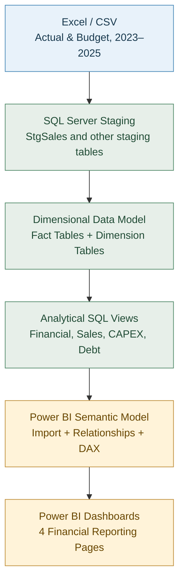

# Financial Analytics SQL & Power BI Portfolio

## 1. Project Overview

**Financial Analytics SQL & Power BI Portfolio** is an end-to-end financial analytics project designed to transform raw financial data into structured, reliable, and interactive management reports.

The project demonstrates the development of a financial reporting solution using **Microsoft SQL Server, T-SQL, Power Query, DAX, and Power BI**.

The solution integrates financial Actual and Budget data for 2023–2025, allowing users to analyze financial performance, identify budget variances, monitor cash flows, and evaluate capital investments and debt.

### Project Objectives

- Build a structured SQL Server database using a dimensional data model.
- Implement data loading and transformation processes.
- Create SQL views to support financial reporting and variance analysis.
- Develop interactive Power BI dashboards for management decision-making.
- Analyze key financial indicators across reporting periods.
- Ensure data consistency through reconciliation and validation.

### Key Analytical Areas

The Power BI solution consists of four dashboard pages:

1. **Financial Summary** — overview of revenue, profitability, cash flow, and financial performance against budget.
2. **Revenue & Gross Profit** — revenue analysis by business line, gross profit margins, and price-volume variance drivers.
3. **Cash Flow & Working Capital** — operating cash flow, working capital movements, and cash flow structure.
4. **CAPEX & Debt Analysis** — capital expenditures, debt balances, financing activities, and interest expenses.

### Project Scope

- **Reporting period:** 2023–2025
- **Reporting frequency:** Quarterly
- **Scenarios:** Actual and Budget
- **Data source:** Anonymized financial datasets prepared in Excel and CSV formats
- **Database platform:** Microsoft SQL Server
- **Reporting platform:** Microsoft Power BI

The project is developed as a portfolio case study to demonstrate practical skills in financial data modeling, SQL development, data transformation, financial analysis, and business intelligence reporting.

## 2. Business Problem

Manufacturing companies generate substantial amounts of financial and operational data across multiple reporting areas, including sales, production costs, operating expenses, working capital, cash flow, capital expenditures, and debt financing.

When financial reporting relies primarily on separate Excel files and manual calculations, management faces several challenges.

### Key Business Challenges

**1. Fragmented Financial Data**

Financial information is stored across multiple worksheets and reporting files, making it difficult to maintain a consistent view of company performance.

**2. Time-Consuming Actual vs Budget Analysis**

Comparing actual financial results with budget targets requires consolidating data from different sources, calculating variances, and identifying the underlying drivers of financial performance.

**3. Limited Visibility into Profitability Drivers**

Traditional financial reports may show changes in revenue and gross profit without clearly explaining the impact of sales volume, pricing, and business-line performance.

**4. Insufficient Cash Flow Transparency**

Changes in accounts receivable, inventory, and accounts payable affect operating cash flow. Without an integrated analytical model, it can be difficult to understand how working capital movements influence liquidity.

**5. Disconnected CAPEX and Debt Reporting**

Capital expenditures, debt balances, loan drawdowns, repayments, and interest expenses are often analyzed separately, limiting management's ability to assess investment activity and financing requirements.

### Proposed Solution

This project addresses these challenges by developing an integrated financial analytics solution that:

- Consolidates Actual and Budget financial data into a structured SQL Server database.
- Standardizes financial indicators, reporting periods, business lines, and scenarios.
- Uses SQL views to prepare consistent datasets for financial analysis.
- Automates financial calculations and variance analysis through SQL and DAX.
- Provides interactive Power BI dashboards for analyzing profitability, liquidity, investments, and debt.
- Enables management to identify financial performance drivers and monitor key indicators across reporting periods.

### Expected Business Value

The solution is designed to reduce manual reporting effort, improve data consistency, increase transparency in financial performance, and support faster, data-driven management decisions.

## 3. Tech Stack

The project combines database development, data transformation, financial analytics, and business intelligence technologies to build an end-to-end financial reporting solution.

### Database & SQL

| Technology                          | Purpose                                                                             |                         
|-------------------------------------|-------------------------------------------------------------------------------------|
| Microsoft SQL Server                | Relational database management and storage of financial data                        |
| T-SQL                               | Database creation, data loading, transformation, validation, and financial analysis |
| SQL Server Management Studio (SSMS) | Database administration, SQL query development, debugging, and data validation      |
| SQL Views                           | Preparation of reusable analytical datasets for Power BI                            |
| Dimensional Data Modeling           | Organization of financial information into fact and dimension tables                |

### Data Preparation & Transformation

| Technology         | Purpose                                                                                      |
|--------------------|----------------------------------------------------------------------------------------------|
| Microsoft Excel    | Source financial datasets containing Actual and Budget information                           |
| CSV                | Intermediate format for transferring financial data into SQL Server                          |
| Power Query        | Data cleaning, restructuring, and preparation for database loading                           |
| SQL Staging Tables | Temporary landing area for imported datasets before transformation into the analytical model |
| T-SQL ETL Scripts  | Loading and transforming source data into fact and dimension tables                          |

### Business Intelligence & Analytics

| Technology              | Purpose                                                                                 |
|-------------------------|-----------------------------------------------------------------------------------------|
| Power BI Desktop        | Development of interactive financial dashboards                                         |
| DAX                     | Calculation of KPIs, financial ratios, budget variances, and analytical measures        |
| Power BI Data Model     | Relationships between reporting views and dimension tables                              |
| Power BI Visualizations | KPI cards, trend charts, variance analysis, waterfall charts, and financial comparisons |

### Development & Version Control

| Technology               | Purpose                                                                       |
|--------------------------|-------------------------------------------------------------------------------|
| Visual Studio Code       | Development and organization of SQL scripts, documentation, and project files |
| Git                      | Version control and tracking of project changes                               |
| GitHub                   | Source code repository, documentation, and portfolio presentation             |
| Power BI Project (.pbip) | Source-controlled Power BI report and semantic model files                    |
| Markdown                 | Project documentation and README development                                  |

### Key Technical Capabilities Demonstrated

- Designing a dimensional financial data model with fact and dimension tables.
- Developing SQL scripts for database creation, data loading, and transformation.
- Implementing staging-to-fact data processing workflows.
- Creating reusable analytical SQL views.
- Applying SQL aggregation, joins, CTEs, and data validation queries.
- Developing DAX measures for financial KPIs and Actual vs Budget analysis.
- Building interactive Power BI reports with consistent visual formatting.
- Managing SQL and Power BI project files through Git and GitHub.

## 4. Data Architecture

The project follows a layered data architecture designed to separate source data preparation, data storage, transformation, analytical modeling, and business intelligence reporting.

Microsoft SQL Server serves as the central data platform, while Power BI provides the analytical and visualization layer.

### 4.1 Architecture Overview

The end-to-end data flow consists of five main layers:

**1. Source Data — Excel & CSV**

Anonymized financial datasets for 2023–2025, containing Actual and Budget information across multiple financial reporting areas.

**2. Staging Layer — SQL Server**

Source datasets are imported into staging tables, including `StgSales`, where data can be inspected, standardized, and prepared for transformation.

**3. Data Warehouse Layer — Dimensional Model**

Validated data is loaded into fact and dimension tables using a star-schema approach.

**4. Analytical Layer — SQL Views**

SQL views combine financial data with reporting dimensions and calculate or expose measures required for financial analysis.

**5. Reporting Layer — Power BI**

Power BI connects to SQL Server, imports analytical datasets, and uses DAX measures and interactive visualizations to deliver management dashboards.

  

### 4.2 Dimensional Data Model

The analytical database is organized around fact and dimension tables.

**Dimension Tables**

| Table                   |                                          Description |
|-------------------------|------------------------------------------------------|
| `DimCompany`            | Company identifiers and reporting entities           |
| `DimPeriod`             | Reporting years, quarters, and chronological sorting |
| `DimScenario`           | Actual and Budget scenarios                          |
| `DimDirection`          | Business lines and operating directions              |
| `DimFinancialIndicator` | Standardized financial indicators                    |
| `DimCapEx`              | Capital expenditure categories                       |
| `DimDebtMetric`         | Debt-related reporting metrics                       |

**Fact Tables**

| Table                                  | Description                                                          |
|----------------------------------------|----------------------------------------------------------------------|
| `FactFinancialData`                    | Financial performance, cash flow, and working capital indicators     |
| `FactSales`                            | Sales volume, selling price, and revenue by business line            |
| `FactCOGS`                             | Cost of goods sold data                                              |
| `FactCapEx`                            | Capital expenditure data                                             |
| `FactDebtSchedule`                     | Debt balances, financing movements, and interest-related information |

Fact tables store quantitative financial data and reference dimension tables through identifiers such as `CompanyId`, `PeriodId`, `ScenarioId`, and `DirectionId`, depending on the fact table's reporting grain.

This structure supports consistent filtering, aggregation, and comparative analysis across reporting periods and scenarios.

### 4.3 Analytical SQL Views

The reporting layer includes reusable SQL views designed to simplify Power BI integration and centralize financial reporting logic.

| SQL View                      | Analytical Purpose                                                   |
|-------------------------------|----------------------------------------------------------------------|
| `vw_FinancialReport`          | Standardized financial reporting dataset                             |
| `vw_ActualVsBudget`           | Comparison of actual performance against budget                      |
| `vw_GrossProfitAnalysis`      | Revenue, cost of sales, gross profit, and profitability analysis     |
| `vw_SalesPriceVolumeAnalysis` | Revenue variance decomposition into price and volume effects         |
| `vw_CapExAnalysis`            | Capital expenditure analysis and budget comparisons                  |
| `vw_DebtAnalysis`             | Debt balances, financing movements, repayments, and interest analysis|

These SQL views provide a reusable analytical interface between the underlying database tables and Power BI.

### 4.4 Power BI Semantic Model

Power BI uses imported SQL datasets and DAX measures to support interactive financial reporting.

The semantic model includes relationships between reporting views and relevant dimensions, including reporting periods and business directions.

DAX measures provide calculations for:

- Actual and Budget financial performance.
- Absolute and percentage variances.
- Revenue and Gross Profit analysis.
- Gross Margin percentages.
- Operating Cash Flow and Working Capital movements.
- CAPEX and debt-related indicators.

The reporting solution consists of four pages: Financial Summary, Revenue & Gross Profit, Cash Flow & Working Capital, and CAPEX & Debt Analysis.

### 4.5 Architectural Benefits

This layered architecture provides several advantages:

- **Separation of responsibilities:** Source preparation, data storage, analytical SQL logic, and dashboard calculations are organized into distinct layers.
- **Consistency:** Standardized dimensions and SQL views support consistent financial reporting.
- **Maintainability:** SQL scripts, data models, and Power BI project files can be maintained independently.
- **Reusability:** Analytical views can support multiple financial reports and visualizations.
- **Data quality:** Reconciliation and validation queries help identify inconsistencies between source and analytical data.
- **Extensibility:** Additional reporting periods, scenarios, financial indicators, and analytical views can be incorporated into the existing architecture.

The overall design demonstrates an end-to-end financial analytics workflow, combining relational data modeling, SQL-based transformation, analytical reporting, and interactive business intelligence.

## 5. ETL Process

The project implements an ETL (Extract, Transform, Load) workflow to convert anonymized financial data from Excel and CSV files into structured SQL Server tables suitable for financial analysis and Power BI reporting.

The workflow combines **Microsoft Excel, Power Query, CSV files, T-SQL scripts, and SQL Server staging tables**.

### 5.1 Source Data Preparation

The source datasets contain quarterly financial Actual and Budget information for 2023–2025.

The data covers the following reporting areas:

- Sales and revenue
- Cost of Goods Sold (COGS)
- Operating Expenses (OPEX)
- Cash Flow and Working Capital
- Capital Expenditures (CAPEX)
- Debt and Interest Expenses

Source files were anonymized to protect business-sensitive information while preserving the structure and relationships required for financial analysis.

### 5.2 Data Extraction

Financial data was extracted from Excel worksheets and prepared for SQL Server loading.

Power Query was used where necessary to restructure source data into a tabular format.

Key preparation activities included:

- Standardizing column names.
- Converting financial indicators into a consistent structure.
- Identifying reporting periods and scenarios.
- Mapping business directions.
- Converting numeric fields into appropriate formats.
- Exporting transformed datasets to CSV files.

This approach supports consistent data loading from different financial reporting worksheets.

### 5.3 Staging Layer

CSV datasets were loaded into SQL Server staging tables before being transferred into the analytical data model.

Staging tables provide an intermediate layer for inspecting and preparing source data.

For example, `StgSales` contains sales information by company, reporting period, scenario, and business direction.

The staging layer supports:

- Initial data inspection.
- Data type and format verification.
- Identification of missing or inconsistent values.
- Reconciliation with source datasets.
- Preparation for loading into fact tables.

T-SQL scripts, including SQL Server bulk-loading operations, were used to import CSV data.

### 5.4 Data Transformation

After loading data into staging tables, T-SQL transformations were used to prepare datasets for the dimensional model.

The main transformation activities included:

**Dimension Mapping**

Source values were mapped to standardized dimension identifiers, such as:

- `CompanyId`
- `PeriodId`
- `ScenarioId`
- `DirectionId`

**Financial Indicator Standardization**

Financial indicators were mapped to predefined reporting definitions to ensure consistent aggregation and analysis.

**Data Aggregation and Restructuring**

Source records were transformed into structures appropriate for the target fact tables, taking into account the reporting grain of each dataset.

**Data Type Conversion**

Financial values were converted into SQL numeric data types suitable for financial calculations and reporting.

### 5.5 Loading into the Dimensional Model

Transformed data was loaded into SQL Server fact tables, including:

| Fact Table          | Data Loaded                                                   |
|---------------------|---------------------------------------------------------------|
| `FactFinancialData` | Financial indicators, cash flow, and working capital          |
| `FactSales`         | Sales volumes, selling prices, and revenue                    |
| `FactCOGS`          | Cost of goods sold                                            |
| `FactCapEx`         | Capital expenditures                                          |
| `FactDebtSchedule`  | Debt balances, financing movements, and interest-related data |

The ETL process maintains relationships between fact tables and their corresponding dimensions.

This enables consistent reporting across companies, quarters, scenarios, and business directions.

### 5.6 Data Validation and Reconciliation

Data validation was performed to verify the accuracy and completeness of the SQL Server analytical datasets.

Validation activities included:

- Comparing SQL query results with original Excel financial datasets.
- Reconciling quarterly Revenue totals between `StgSales` and `FactSales`.
- Checking for duplicate business keys in `FactSales`.
- Verifying the presence of expected business directions across reporting periods and scenarios.
- Comparing Revenue by business direction between staging and fact tables.
- Investigating and correcting identified data inconsistencies.

Dedicated SQL validation scripts were developed to make selected checks reproducible.

### 5.7 ETL Workflow Summary

The resulting workflow follows this sequence:

**Excel Source Data → Power Query Preparation → CSV Export → SQL Server Staging → T-SQL Transformation → Fact & Dimension Tables → Analytical SQL Views → Power BI**

This approach separates data preparation, storage, transformation, and reporting responsibilities.

The ETL implementation demonstrates practical experience in data integration, SQL development, dimensional modeling, and financial data quality management.

## 6. Dashboard Pages

The Power BI reporting solution consists of four interactive dashboard pages designed to provide an integrated view of financial performance, profitability, cash flow, capital investments, and debt.

The dashboards use SQL Server analytical views and DAX measures to support quarterly financial analysis, Actual vs Budget comparisons, and management decision-making.

### 6.1 Financial Summary

**Purpose:** Provide management with a high-level overview of the company's financial performance and key financial indicators.

**Key KPIs:**
- Revenue
- EBITDA
- Net Profit
- Operating Cash Flow
- Closing Cash Balance

**Key Visualizations:**
- KPI cards showing Actual, Budget, and Variance %.
- Actual vs Budget comparison by financial indicator.
- Quarterly trends for Revenue, EBITDA, and Net Profit.
- Financial performance comparison table.
- Interactive reporting period slicer.

**Business Value:**

Enables management to evaluate overall financial performance, identify significant budget deviations, and monitor profitability and liquidity trends.

### 6.2 Revenue & Gross Profit

**Purpose:** Analyze revenue and profitability by business direction and identify the main factors driving deviations from budget.

**Key KPIs:**
- Revenue Actual vs Budget
- Gross Profit Actual vs Budget
- Gross Margin %

**Key Visualizations:**
- Revenue Actual vs Budget by Business Line.
- Revenue Variance Drivers waterfall chart.
- Gross Profit and Gross Margin by Business Line.
- Interactive Period and Direction slicers.

**Analytical Capabilities:**
- Revenue comparisons across business directions.
- Analysis of sales volume and price effects.
- Gross Profit and Gross Margin performance analysis.
- Identification of business lines contributing to financial variances.

**Business Value:**

Helps management understand the sources of revenue changes, assess profitability across business lines, and identify areas requiring commercial or operational attention.

### 6.3 Cash Flow & Working Capital

**Purpose:** Evaluate cash generation, liquidity, and the impact of working capital movements on operating cash flow.

**Key KPIs:**
- Operating Cash Flow
- Closing Cash Balance
- Net Cash Flow
- CAPEX
- Working Capital Impact

**Key Visualizations:**
- Cash Flow Structure waterfall chart.
- Working Capital Drivers waterfall chart.
- Quarterly cash flow trends.
- Actual vs Budget cash flow comparisons.

**Analytical Capabilities:**
- Monitoring operating cash flow performance.
- Analyzing changes in accounts receivable, inventory, and accounts payable.
- Evaluating working capital effects on cash generation.
- Identifying drivers of cash flow deviations from budget.

**Business Value:**

Supports liquidity management by connecting financial performance with working capital movements and cash flow generation.

### 6.4 CAPEX & Debt Analysis

**Purpose:** Monitor capital expenditure performance, debt balances, financing activities, and interest costs.

**Key KPIs:**
- CAPEX
- Closing Debt
- Drawdown
- Repayment
- Interest Expense

**Key Visualizations:**
- CAPEX Actual vs Budget by Category.
- Quarterly CAPEX Trend.
- Closing Debt Trend.
- Debt Movement waterfall chart.
- Interest Rate & Interest Expense combined chart.

**Analytical Capabilities:**
- Monitoring capital investments against budget.
- Analyzing CAPEX allocation by category.
- Tracking debt balances over time.
- Reviewing debt drawdowns and repayments.
- Assessing interest expenses and interest rate trends.

**Business Value:**

Provides management with visibility into capital investment activity, financing requirements, debt movements, and borrowing costs.

### 6.5 Dashboard Design & Interactivity

The dashboards follow a consistent visual design to improve readability and support executive-level financial analysis.

Key design principles include:

- Consistent page layouts and KPI card formatting.
- Clear visual distinction between Actual and Budget results.
- Conditional formatting of financial variances based on business interpretation.
- Interactive period and business direction filtering.
- Consistent colors, typography, borders, and chart formatting.
- Use of waterfall charts to explain financial movements and variance drivers.

The reporting interface is designed to allow users to move from a high-level financial overview to more detailed analysis of profitability, cash flow, investments, and debt.